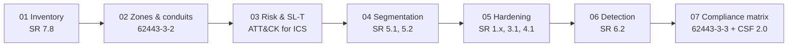
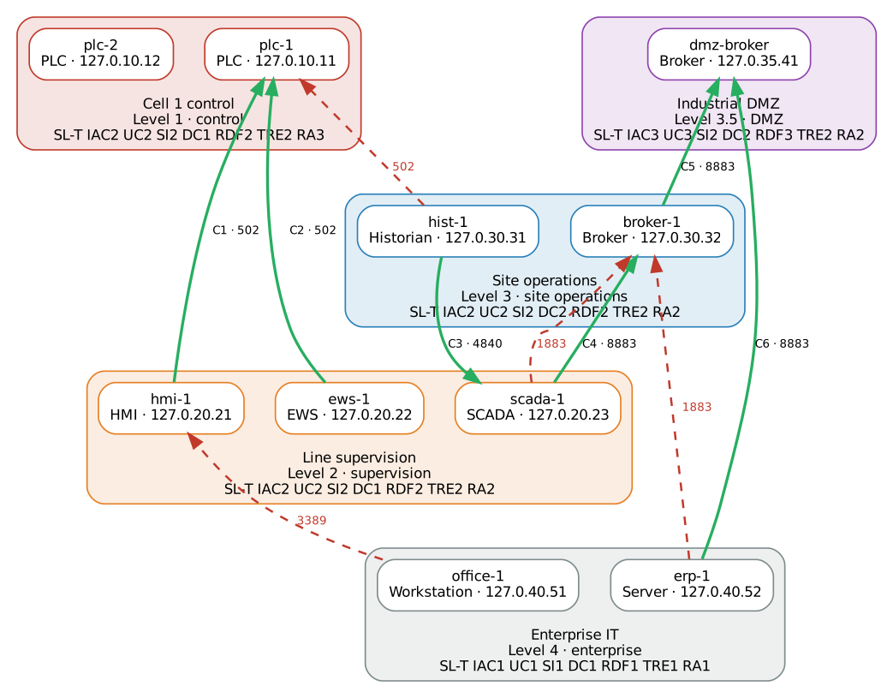
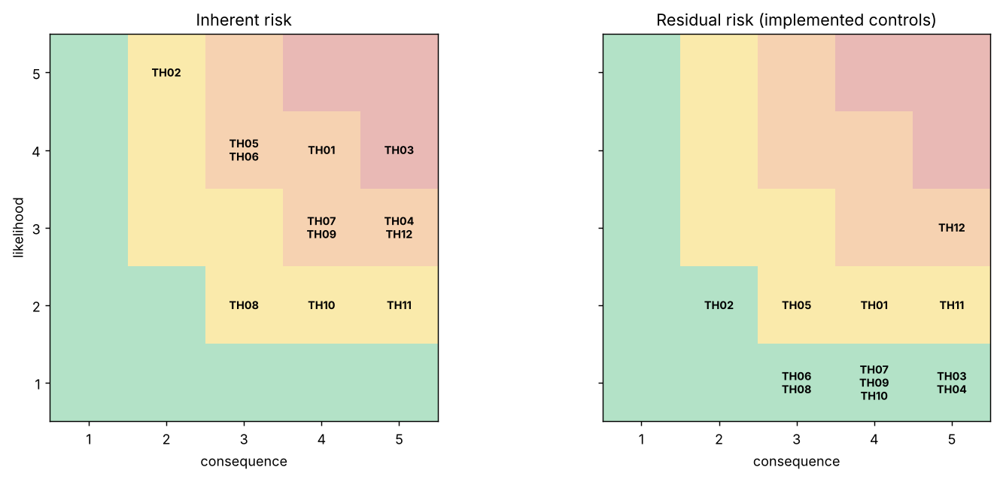
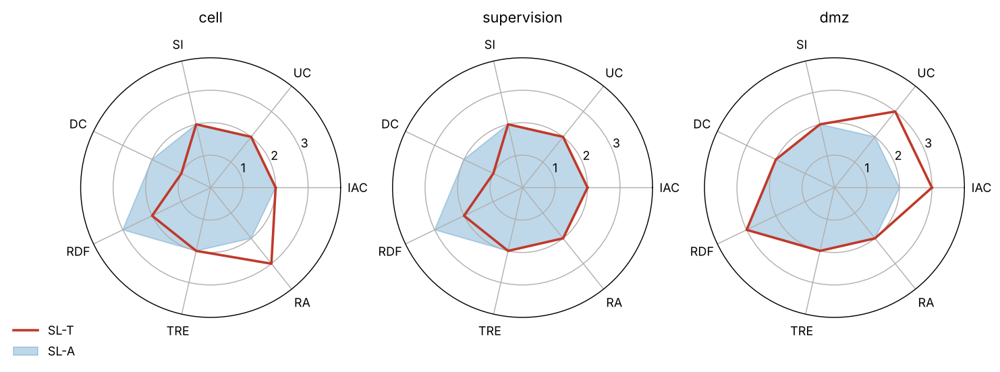
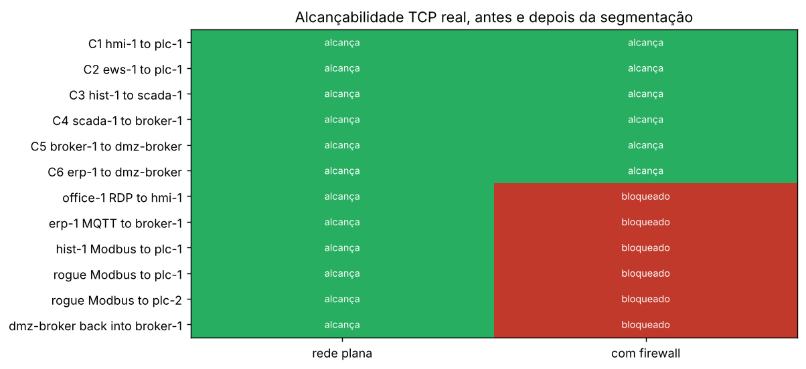
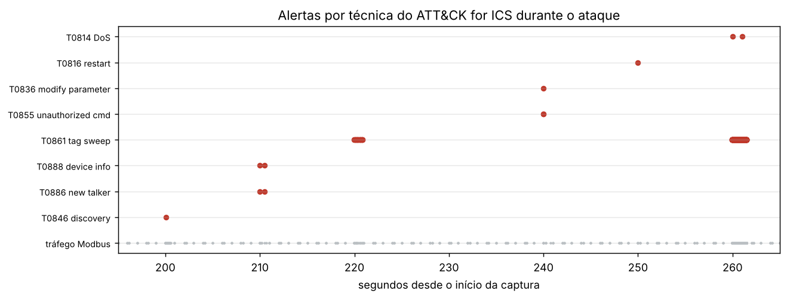
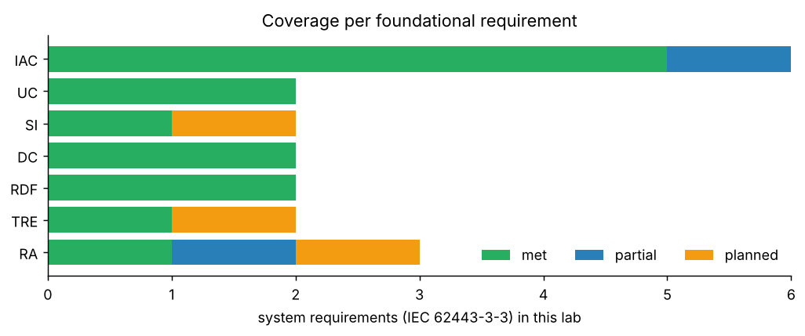

# ot-security-lab

**A hands-on OT cybersecurity lab, written as a study guide and built on the official references: IEC 62443, NIST SP 800-82 Rev. 3, NIST CSF 2.0 and MITRE ATT&CK for ICS.**

A fictional bottling plant (PLCs on Modbus, SCADA on OPC UA, a UNS on MQTT) is taken from *as found* to *defended*: passive inventory, zones and conduits, risk assessment, a real default-deny firewall, protocol hardening, an intrusion detector, and a compliance matrix that is computed from the test run. Everything is defensive, runs on one Linux machine, and is checked in CI.

[](https://github.com/MatheusEduGarcia/ot-security-lab/actions/workflows/ci.yml)


> **How to read this page.** Each exercise shows the idea, the reference it applies, the result, and what the result means. The eight notebooks in [`notebooks/`](notebooks/) walk the same path in Portuguese, with every cell commented and every output kept.

> **Scope.** Defensive only. All traffic is synthetic or runs on loopback addresses inside the lab; no exploit code and nothing aimed at real equipment. The IEC 62443 standards are sold by IEC/ISA: this repository cites requirement identifiers and explains them in its own words, without reproducing normative text.

---

## Contents

0. [The references and how they fit](#0-the-references-and-how-they-fit)
1. [Passive asset inventory](#1-passive-asset-inventory)
2. [Zones and conduits](#2-zones-and-conduits-iec-62443-3-2)
3. [Risk assessment with ATT&CK for ICS](#3-risk-assessment-with-attck-for-ics)
4. [Segmentation that is actually enforced](#4-segmentation-that-is-actually-enforced)
5. [Protocol hardening: MQTT and OPC UA](#5-protocol-hardening-mqtt-and-opc-ua)
6. [Intrusion detection for Modbus](#6-intrusion-detection-for-modbus)
7. [Compliance as code](#7-compliance-as-code)
8. [Run it yourself](#8-run-it-yourself)

---

## 0. The references and how they fit

| Reference | Publisher | Question it answers | Used in |
|---|---|---|---|
| **IEC 62443** series | IEC / ISA | How to design, run and maintain a secure automation system | 02, 03, 07 |
| **NIST SP 800-82 Rev. 3** | NIST, 2023 | Practical OT security architectures and controls | 04, 06 |
| **NIST CSF 2.0** | NIST, 2024 | How to organize a security program (Govern, Identify, Protect, Detect, Respond, Recover) | 07 |
| **MITRE ATT&CK for ICS** | MITRE | What attackers actually do in industrial environments | 03, 06 |
| **Purdue model** | industry | The layers of a plant network | 02 |
| **ANEEL REN 964/2021, ONS RO-CB.BR.01** | Brazilian regulators | Minimum cyber controls for the power sector | context |

The lab follows the order suggested by IEC 62443-3-2: **know** the system, **divide** it, **assess** risk, **protect**, **detect**, and **prove** it.



**The seven foundational requirements (FR)** of IEC 62443-3-3, used throughout: IAC identification and authentication control, UC use control, SI system integrity, DC data confidentiality, RDF restricted data flow, TRE timely response to events, RA resource availability. **Security levels** go from SL 1 (casual violation) to SL 4 (sophisticated attacker with extended resources); each zone gets a target (SL-T), and the controls determine what it achieves (SL-A).

---

## 1. Passive asset inventory

**Idea.** Listen before you touch. Active scans have crashed old PLCs in production, so OT inventories start from a mirror port. Captures are synthetic pcaps generated by [`otsec/traffic.py`](otsec/traffic.py) and open in Wireshark.

**What ten minutes of listening revealed:**

| Finding | Why it matters |
|---|---|
| All 10 documented devices seen, and nothing else | the documented list is correct, for now |
| **RDP open on the HMI**, used from an office PC | a forgotten remote support path, the classic ransomware entry |
| The historian **reads a PLC directly** | it should read through SCADA over OPC UA |
| **MQTT in clear text with the SCADA password** (`Acme2024!`) | anyone on a mirror port has the credentials (T0842) |
| On the attack day, an IP and MAC **not in the inventory** talking to 30 addresses | inventory diff is already a rogue device detector |

---

## 2. Zones and conduits (IEC 62443-3-2)

**Idea.** Group assets with the same risk into **zones**, and allow traffic between zones only through **conduits** with explicit rules. The design is data ([`model/zones.yaml`](model/zones.yaml)), so it is versioned, reviewed and tested. Design rules reject, for example, any conduit from IT that does not go through the DMZ.

Green is what the design allows. Red dashed is what the as-found capture shows:



| Observed flow | Verdict |
|---|---|
| `erp-1 → broker-1 :1883` | enterprise reaches the plant without passing through the DMZ |
| `office-1 → hmi-1 :3389` | enterprise reaches the plant without passing through the DMZ |
| `hist-1 → plc-1 :502` | no conduit from site operations to the cell |
| `scada-1 → broker-1 :1883` | right peers, wrong port: conduit C4 requires 8883 (TLS) |

---

## 3. Risk assessment with ATT&CK for ICS

**Idea.** Twelve threat scenarios, each anchored in a real ATT&CK for ICS technique (T0855 Unauthorized Command Message, T0836 Modify Parameter, T0842 Network Sniffing, T0814 Denial of Service, ...). Risk is likelihood × consequence; implemented controls lower the likelihood ([`model/threats.yaml`](model/threats.yaml)).



* **TH03 Unauthorized Command Message** drops from **critical (20)** to **low (5)**. Modbus has no authentication, so the only defenses are who can reach port 502 and who notices.
* **TH12 Removable Media** stays **high**: no control is implemented for it yet. The lab shows residual risk instead of hiding it.

**SL-T vs SL-A** (a simplified self-assessment, explained in the notebook): where the blue area does not reach the red line there is work left.



The cell needs RA 3 (availability is what matters on a PLC) but the IDS only detects floods without limiting them; the DMZ needs IAC and UC 3, which calls for MFA on remote access.

---

## 4. Segmentation that is actually enforced

**Idea.** The conduit list **generates** a default-deny firewall (`iptables`, chain `OTLAB`), with the conduit ID in each rule's comment for traceability. Each zone lives on its own loopback subnet (`127.0.10.0/24` cell, `127.0.20.0/24` supervision, ...), real TCP servers listen on every asset service, and real connections are attempted before and after.

```
iptables -A OTLAB -s 127.0.20.22 -d 127.0.10.11 -p tcp --dport 502 -m comment --comment C2 -j ACCEPT
...
iptables -A OTLAB -s 127.0.40.0/24 -d 127.0.10.0/24 -p tcp -j REJECT --reject-with tcp-reset
```



All six conduits still work; all six bad paths are closed. A real Modbus server makes the point clearly:

```
flat network, rogue laptop : write accepted, register 100 = 9999
with firewall, rogue laptop: connection refused
with firewall, EWS         : write accepted, register 100 = 470
```

For protocols with no security of their own, **segmentation is the authentication**.

---

## 5. Protocol hardening: MQTT and OPC UA

**Idea.** Turn on the security that MQTT and OPC UA already have, and prove it with real servers (mosquitto, asyncua). A private CA, certificates and random passwords are generated at runtime under `configs/runtime/` (git-ignored): **no key or password is committed**.

**MQTT broker, before and after**

| Attempt | 1883, as found | 8883, hardened |
|---|---|---|
| anonymous client | connected | refused: not authorized |
| right password, no TLS | connected, **password visible on the wire** | refused |
| client that does not trust the plant CA | n/a | refused: certificate verify failed |
| `scada` publishes into Curitiba's tree | delivered | **dropped by ACL** |
| `historian` tries to publish | delivered | **dropped by ACL** (read only) |
| capture of the login | `...\x05scada\x00\tAcme2024!...` | password not found in the bytes |

**OPC UA server** (Basic256Sha256 SignAndEncrypt only, plant CA trust list, user login)

| Client | Result |
|---|---|
| SecurityPolicy None | refused: no matching endpoints |
| self-signed unknown certificate | refused: `BadCertificateUntrusted` |
| trusted certificate, no user | refused: `BadIdentityTokenRejected` |
| trusted certificate, correct login | connected, reads `Speed = 468.0` |

---

## 6. Intrusion detection for Modbus

**Idea.** OT traffic is repetitive: the same hosts read the same registers with the same function codes all day. A small **allowlist IDS** learns day 1 and alerts on anything new ([`otsec/ids.py`](otsec/ids.py)). It is scored honestly: false positives on a separate normal day, detection on an attack capture labelled packet by packet.

| Rule | Reveals |
|---|---|
| R1 one source probes many hosts | T0846 Remote System Discovery |
| R2 pair never seen before | T0886 Remote Services |
| R3 function code new for this pair | T0888, T0816, T0855 |
| R4 reads outside the usual register map | T0861 Point & Tag Identification |
| R5 write from a pair that never writes | T0855 Unauthorized Command Message |
| R6 written value outside the learned range | T0836 Modify Parameter |
| R7 request rate far above baseline | T0814 Denial of Service |



**Result: 6 of 6 techniques detected, 0 false positives on the normal day, detection on the first packet of each phase.** The notebook also lists the limits, such as an attacker who uses the real engineering workstation and writes a value inside the normal range.

---

## 7. Compliance as code

**Idea.** Every control lists the pytest tests that prove it. The matrix runs the tests and marks a requirement as met **only if its evidence passes on this machine**. If someone turns TLS off on the broker, the test fails and the requirement drops out.



| SR (IEC 62443-3-3) | Requirement | Controls | Status |
|---|---|---|---|
| SR 1.1 | Human user identification and authentication | CTL-MQTT-AUTH, CTL-OPCUA-SEC | ✅ met |
| SR 1.2 | Software process and device identification and authentication | CTL-OPCUA-SEC | ✅ met |
| SR 1.13 | Access via untrusted networks | CTL-DMZ, CTL-MFA | 🔷 partial |
| SR 2.1 | Authorization enforcement | CTL-FW, CTL-MQTT-ACL | ✅ met |
| SR 3.1 | Communication integrity | CTL-MQTT-TLS, CTL-OPCUA-SEC | ✅ met |
| SR 3.2 | Malicious code protection | CTL-ALLOWLIST | 🟧 planned |
| SR 4.1 | Information confidentiality | CTL-MQTT-TLS, CTL-OPCUA-SEC | ✅ met |
| SR 5.1 | Network segmentation | CTL-ZONES, CTL-FW | ✅ met |
| SR 5.2 | Zone boundary protection | CTL-FW, CTL-DMZ | ✅ met |
| SR 6.1 | Audit log accessibility | CTL-SIEM | 🟧 planned |
| SR 6.2 | Continuous monitoring | CTL-IDS | ✅ met |
| SR 7.1 | Denial of service protection | CTL-IDS | 🔷 partial |
| SR 7.3 | Control system backup | CTL-BACKUP | 🟧 planned |
| SR 7.8 | Control system component inventory | CTL-INV | ✅ met |

The full generated table is in [`docs/compliance_matrix.md`](docs/compliance_matrix.md). Seen through **NIST CSF 2.0**, the lab is strong on Identify, Protect and Detect, and has nothing yet on Respond and almost nothing on Recover: the natural next steps are an OT incident response plan, tabletop exercises and tested PLC restores.

---

## 8. Run it yourself

```bash
sudo apt install mosquitto graphviz iptables     # Debian/Ubuntu
pip install -r requirements.txt
python -m otsec.traffic                          # regenerate the captures (already committed)
sudo -E env "PATH=$PATH" python -m pytest -q     # 19 tests; root for iptables and loopback capture
jupyter lab notebooks/
```

Without root, the firewall and capture tests are skipped and everything else runs. The lab only changes its own `OTLAB` iptables chain and removes it afterwards.

### Layout

| Path | What |
|---|---|
| `model/` | plant, zones and conduits, threats, requirements and controls (YAML) |
| `captures/` | synthetic pcaps and the attack ground truth |
| `otsec/` | traffic generator, inventory, zones, risk, segmentation, hardening, IDS, compliance |
| `notebooks/` | 00 references · 01 inventory · 02 zones · 03 risk · 04 segmentation · 05 hardening · 06 detection · 07 compliance |
| `tests/` | the evidence behind every control |
| `docs/` | figures and the generated compliance matrix |

### Related

* [iiot-protocols-examples](https://github.com/MatheusEduGarcia/iiot-protocols-examples): the protocols hardened here, from the basics.
* [industrial-ontology-lab](https://github.com/MatheusEduGarcia/industrial-ontology-lab): the same kind of plant as a knowledge graph.

MIT License.
